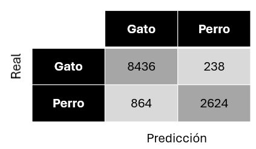

## Práctica 3. Detección y reconocimiento de formas

### Contenidos

[Aspectos cubiertos](#31-aspectos-cubiertos)  
[Entrega](#32-entrega)

### 3.1. Aspectos cubiertos

En esta práctica el objetivo es adquirir nociones para extraer información geométrica de objetos presentes en una imagen, con el fin de caracterizarlos y posteriormente ser capaz de identificarlos de forma automática en categorías. Si bien se reitera en el apartado de la entgera, **no se plantea** para la resolución de las tareas, la utilización de **modelos de aprendizaje profundo**. El cuaderno de la práctica, *VC_P3.ipynb*, contiene diversos ejemplos mostrando variantes para la detección de objetos presentes en la imagen, como paso previo a su caracterización geométrica. En este sentido, se plantea el uso del umbralizado y la detección de contornos. Para el caso concreto de monedas, se considera también la utilización de la transformada de Hough para la localización de formas circulares.


Si bien no es necesario instalar paquetes adicionales para las primeras celdas del cuaderno, de cara a poder obtener la matriz de confusión, es requisito instalar en el *environment* los paquetes *scikit-learn* y *seaborn* para disponer de utilidades para el cálculo de [métricas](https://developers.google.com/machine-learning/crash-course/classification/accuracy-precision-recall?hl=es-419). Con *pip* sería algo como:

```
pip install scikit-learn seaborn
```

### 3.2. Entrega

Para la entrega de esta práctica, son **dos las tareas planteadas**. Para ninguna de ellas deben integrar modelos de **aprendizaje profundo**:

- En la **primera tarea**, el reto o tarea consiste en determinar la cantidad de dinero y monedas presentes en la imagen captada en vivo con la webcam. Una extensión válida sería la presencia de objetos que no sean monedas en la imagen analizada.

- En la **segunda tarea**, deben desarrollar un procedimiento que extraiga partículas de una imagen de test, y las clasifique en tres clases posibles. Deben tener claro que la imagen de test no puede utilizarse para ajustar el procedimiento, para ello cuentan con las imágenes de entrenamiento. En este sentido, además de la imagen de test *MPs_test.jpg* con su correspondiente archivo de anotaciones *MPs_test_bbs.csv*, se proporcionan de cara al entrenamiento, imágenes de tres clases de objetos recogidos en playas canarias: fragmentos plásticos, *pellets* y alquitrán. Para cada categoría se proporciona una imagen completa y una subimagen de la misma. Las dos primeras categorías se consideran microplásticos cuando miden menos de 5mm, mientras que la tercera es muy habitual encontrarlas en playas canarias. Observar que dado que cada imagen contiene muestras de una única categoría, a efectos prácticos disponen de un conjunto de datos anotado. La tarea propuesta consiste en hacer uso de las imágenes de entrenamiento proporcionadas, extraer de forma automatizada las partículas e identificar patrones en sus características geométricas y de apariencia o entrenar un clasificador con ellas, que puedan permitir la clasificación de las partículas en la imagen de test. El resultado obtenido en la imagen de test, debe mostrarse por medio las métricas mostradas en el cuaderno, incluyendo la matriz de confusión, donde se comparan las anotaciones con las predicciones.

  
*Ejemplo de matriz de confusión*

A la hora de considerar posibles características geométricas, como punto de partida para la extracción de descriptores de las partículas, se proporciona enlace al trabajo [SMACC: A System for Microplastics Automatic Counting and Classification](https://doi.org/10.1109/ACCESS.2020.2970498) en el que se adoptan algunas propiedades geométricas para dicho fin. De forma resumida, las características geométricas utilizadas en dicho trabajo fueron:

- Área en píxeles (A)
- Perímetro en píxeles (P)
- Compacidad (relación del cuadrado del perímetro con el área C=P^2/A)
- Relación del área de la partícula con el área del contenedor que la contiene
- Relación del ancho y el alto del contenedor
- Relación entre los ejes de la elipse ajustada
- Definido el centroide, relación entre las distancias menor y mayor al contorno

En relación a la segmentación de las partículas, una probable primera observación es que la aplicación del umbralizado para separarlas del fondo, es delicada. Preprocesamiento como el ecualizado del histograma, suavizar la imagen de entrada o reducir su tamaño, o aplicar heurísticas basadas en el tamaño mínimo y máximo de los contornos localizados, y la distancia mínima entre ellos, pueden ayudar a filtrar falsas detecciones, pero a pesar de ello, será un desafío obtener una separación perfecta para todas las imágenes con la misma estrategia. Añadir, que la imagen de fragmentos contiene unas 80 partículas, la de *pellets* unas 55 y la de alquitrán unas 54.

<!--
  
*Ejemplo ilustrativo contornos detectados en la imagen de fragmentos*

Si quieren ir más allá, sugerir explorar técnicas de segmentación recientes y potentes como [Segment anything o SAM](https://segment-anything.com) o [OneFormer](https://github.com/SHI-Labs/OneFormer), y extensiones como , [SAM 2](https://github.com/facebookresearch/segment-anything-2), [FastSAM](https://github.com/CASIA-IVA-Lab/FastSAM) o [Count anything](https://github.com/ylqi/Count-Anything). No duden en compartir otras alternativas que descubran.-->

Como en las prácticas previas, la entrega se realizará a través del campus virtual, remitiendo un enlace al repositorio **github**, donde se alojará el **cuaderno o cuadernos** de resolución de las tareas, además de su correspondiente **README** describiendo el proceso adoptado para resolver cada tarea, detallar la asistencia recibida por herramientas de IA, integrando de imágenes ilustrativas, además de las métricas obtenidas y matriz de confusión de la segunda tarea.

<!---Momentos en trabajo de Nayar sobre Binary images https://cave.cs.columbia.edu/Statics/monographs/Binary%20Images%20FPCV-1-3.pdf -->


***
Bajo licencia de Creative Commons Reconocimiento - No Comercial 4.0 Internacional

## Resolución de la primera tarea

La solución se encuentra implementada en:
- El cuaderno principal [VC_P3.ipynb](VC_P3.ipynb) (celda añadida bajo la descripción de la Tarea 1).
- El script de ejecución directa con webcam: [tarea1_monedas.py](tarea1_monedas.py).

### Funcionamiento sencillo (conteo por radio relativo)

Asumiendo que sobre un folio o superficie blanca se colocan las 8 monedas de euro (desde 2 € hasta 1 céntimo):

1. **Captura y umbralizado**: La webcam toma el fotograma, se pasa a escala de grises, se suaviza y se binariza con umbral Otsu (`cv2.THRESH_BINARY_INV + cv2.THRESH_OTSU`), separando de forma directa las monedas (oscuras) del fondo blanco.
2. **Círculos mínimos**: Se obtienen los contornos externos y para cada uno se calcula su círculo mínimo envolvente (`cv2.minEnclosingCircle`), obteniendo su centro $(x, y)$ y radio en píxeles.
3. **Referencia de escala**: Se toma el mayor radio del frame como referencia y se compara cada radio con los cocientes de los diámetros oficiales del euro.
4. **Asignación por tamaño, no por posición**: Cada moneda se asigna a la denominación cuyo diámetro relativo es más cercano:
   - 1ª más grande: **2.00 €** (25.75 mm, ratio relativo 1.00)
   - 2ª: **0.50 €** (24.25 mm, ratio relativo ~0.94)
   - 3ª: **1.00 €** (23.25 mm, ratio relativo ~0.90)
   - 4ª: **0.20 €** (22.25 mm, ratio relativo ~0.86)
   - 5ª: **0.05 €** (21.25 mm, ratio relativo ~0.83)
   - 6ª: **0.10 €** (19.75 mm, ratio relativo ~0.77)
   - 7ª: **0.02 €** (18.75 mm, ratio relativo ~0.73)
   - 8ª más pequeña: **0.01 €** (16.25 mm, ratio relativo ~0.63)
5. **Repeticiones**: La clasificación se realiza de forma independiente para cada contorno. Por ello, dos monedas con el mismo tamaño reciben el mismo valor y las dos se suman al total.
6. **Visualización y conteo**: Se dibuja cada círculo en verde con su valor en euros y radio relativo, y en la parte superior se muestra el número de monedas detectadas y el total acumulado.

### Ejecución

Desde la carpeta `P3`:
```bash
python tarea1_monedas.py
```
Pulsa `q` en la ventana de OpenCV para salir.

## Resolución de la segunda tarea

La solución se encuentra implementada en [tarea2_microplasticos.py](tarea2_microplasticos.py) y se ejecuta también desde el cuaderno [VC_P3.ipynb](VC_P3.ipynb). Se puede lanzar desde `P3` con:

```bash
python tarea2_microplasticos.py
```

### Procedimiento

1. **Segmentación de entrenamiento**: para cada imagen (`FRA.png`, `PEL.png` y `TAR.png`) se estima un fondo suavizado con un filtro gaussiano. La diferencia absoluta entre la imagen y ese fondo se umbraliza y se limpia con una apertura morfológica. Los contornos válidos se convierten en muestras de entrenamiento.
2. **Características**: de cada partícula se extraen intensidad, saturación, brillo, diferencias de color respecto al fondo, área relativa, compacidad, relación de aspecto, extensión, solidez y tamaño de la máscara.
3. **Clasificación**: se entrena un `ExtraTreesClassifier` clásico con las muestras extraídas de las tres imágenes. Se utilizan las características geométricas y relativas, que son menos sensibles a la iluminación. No se utiliza aprendizaje profundo.
4. **Evaluación**: cada caja de `MPs_test_bbs.csv` se recorta automáticamente de `MPs_test.jpg`, se calculan sus mismas características y se predice una de las clases `FRA`, `PEL` o `TAR`. Las etiquetas del CSV sólo se usan para comparar predicciones y calcular las métricas.

La última ejecución produjo:

| Métrica | Resultado |
| --- | ---: |
| Accuracy | 0.7000 |
| Precision ponderada | 0.7096 |
| Recall ponderado | 0.7000 |
| F1 ponderado | 0.7000 |

La matriz de confusión, en el orden `FRA`, `PEL`, `TAR`, fue:

```text
[[47, 12,  7],
 [12, 23,  3],
 [ 2,  0, 14]]
```

El resultado visual se guarda en [tarea2_resultado.png](tarea2_resultado.png), mostrando la matriz y las cajas con el formato `predicción/anotación`.
