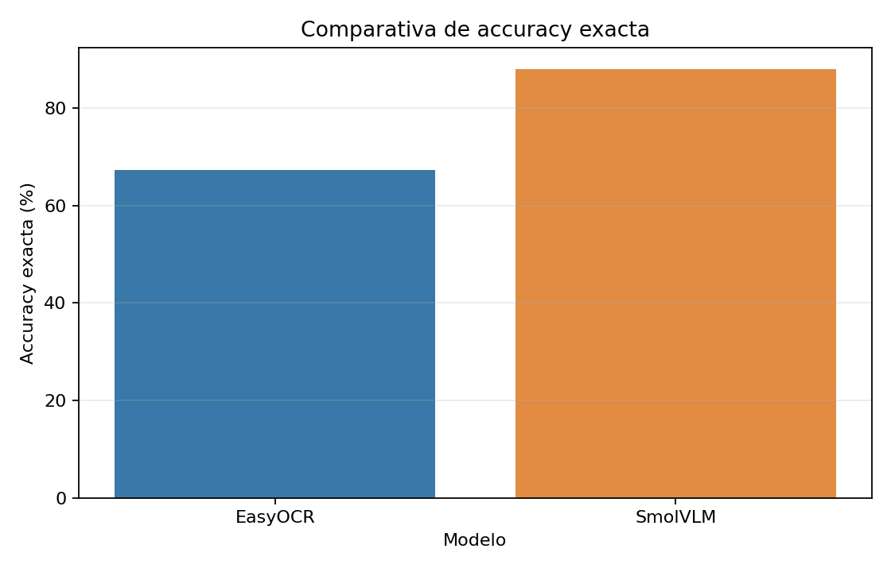
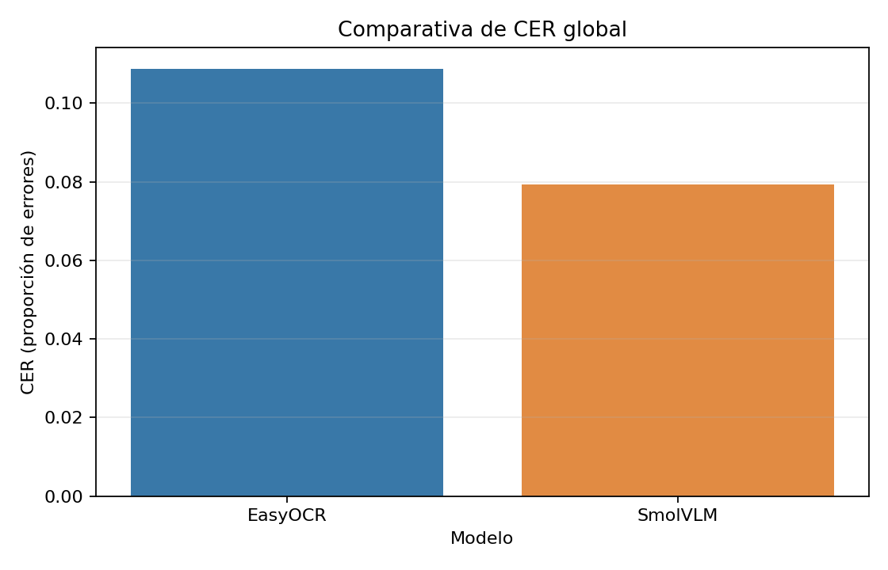
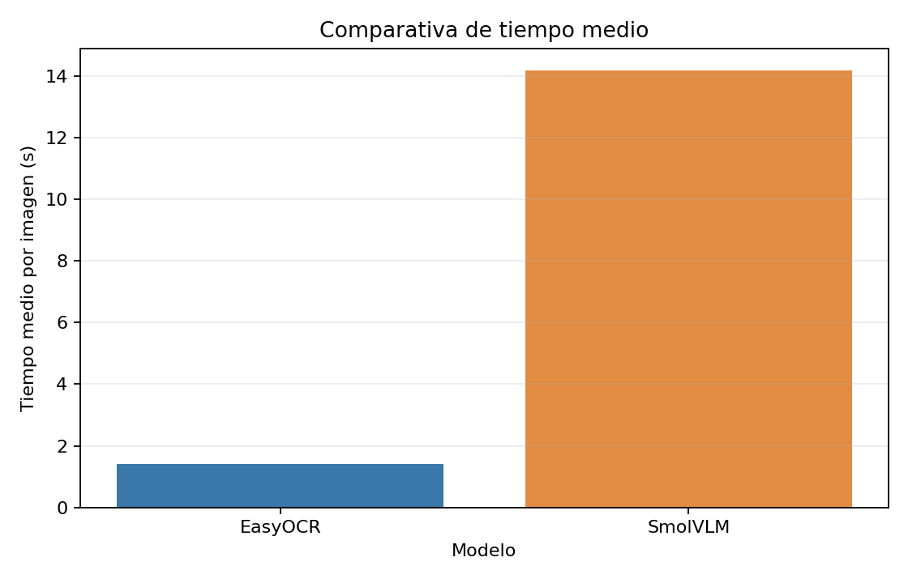
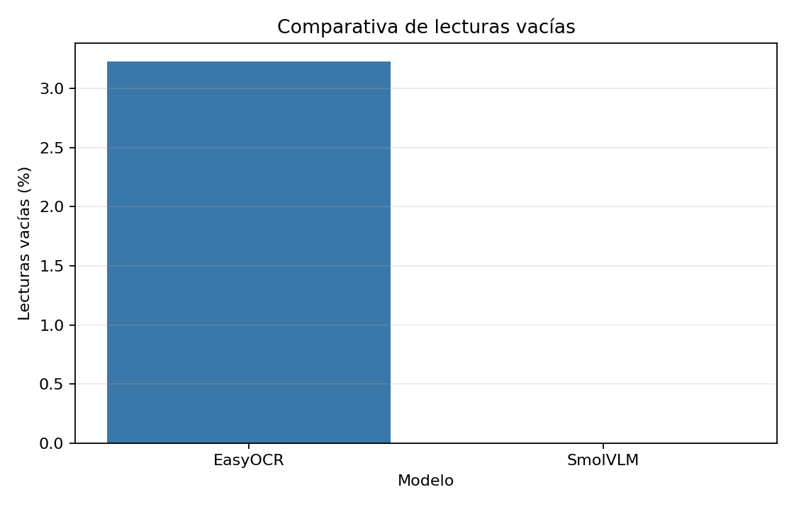

# Práctica 4 — Detección de vehículos y matrículas

Esta práctica desarrolla un prototipo de visión por computador que procesa vídeo para **detectar y seguir vehículos y personas**, **localizar y leer matrículas**, **volcar los resultados a CSV**, **generar un vídeo anotado** y **proteger la privacidad** de las personas y matrículas en el vídeo guardado.

El trabajo cubre las dos tareas de la práctica:

- **P4a — Detección y seguimiento:** detector general, detector de matrículas entrenado y *tracking* de objetos.
- **P4b — OCR:** reconocimiento de caracteres en las matrículas y comparativa entre un OCR clásico y un modelo de lenguaje visual (VLM).

---

## Índice

1. [Introducción](#1-introducción)
2. [Arquitectura y flujo de funcionamiento](#2-arquitectura-y-flujo-de-funcionamiento)
3. [Entrenamiento del modelo YOLO](#3-entrenamiento-del-modelo-yolo)
4. [Resultados del entrenamiento](#4-resultados-del-entrenamiento)
5. [Comparativa de modelos OCR](#5-comparativa-de-modelos-ocr)
6. [Modelos utilizados en el sistema final](#6-modelos-utilizados-en-el-sistema-final)
7. [Privacidad](#7-privacidad)
8. [Conclusiones](#8-conclusiones)
9. [Ejecución](#9-ejecución)

---

## 1. Introducción

### 1.1 Objetivo

El objetivo es construir un *pipeline* completo capaz de recibir un vídeo y, fotograma a fotograma:

1. Detectar personas, bicicletas, coches, motocicletas, autobuses y camiones.
2. Asignar un identificador de seguimiento a cada objeto.
3. Detectar la matrícula de cada vehículo y reconocer su texto.
4. Guardar un CSV con todas las detecciones, coordenadas, matrículas y textos.
5. Generar un vídeo con las cajas, etiquetas, identificadores y matrículas leídas.
6. Pixelar las matrículas y las personas en el vídeo resultante para preservar su privacidad.

### 1.2 Problema que se resuelve

La lectura automática de matrículas en vídeo es difícil por varios motivos:

- Las matrículas ocupan **muy pocos píxeles** dentro del fotograma.
- Aparecen con **ángulos, desenfoque de movimiento, sombras y reflejos**.
- Los vehículos se **solapan** y desaparecen parcialmente.
- El OCR debe distinguir caracteres muy parecidos (`0/O`, `8/B`, `M/N`, `V/W`).
- Procesar muchos fotogramas con un modelo grande puede ser **demasiado lento**.

A esto se añade un requisito de privacidad: el vídeo final no debe permitir leer las matrículas ni reconocer los rasgos de las personas.

### 1.3 Descripción general del sistema

El sistema combina dos detectores YOLO y un OCR:

| Etapa | Tecnología |
|---|---|
| Detección general y *tracking* | YOLO11n preentrenado en COCO + BoT-SORT |
| Detección de matrículas | YOLO11n entrenado con el dataset propio (`best.pt`) |
| Reconocimiento de caracteres | EasyOCR |
| Comparativa experimental | SmolVLM-500M-Instruct |
| Procesado de imagen y vídeo | OpenCV |
| Privacidad | Pixelado propio con OpenCV/NumPy |

El flujo final está implementado en `deteccion_video.py`, el pixelado en `pixelear.py` y la comparativa OCR en `comparativa/`.

---

## 2. Arquitectura y flujo de funcionamiento

### 2.1 Flujo de datos

```text
Vídeo de entrada
      │
      ▼
┌─────────────────────────────────────────────┐
│ YOLO11n COCO + BoT-SORT                     │
│ personas, bicicletas, coches, motos,        │
│ autobuses y camiones + ID de tracking       │
└─────────────────────────────────────────────┘
      │
      ├── persona ──────────────────────────────┐
      │                                         │
      └── vehículo                              │
             │                                  │
             ▼                                  │
      recorte del vehículo                      │
             │                                  │
             ▼                                  │
      YOLO de matrículas (best.pt)              │
             │                                  │
             ▼                                  │
      recorte de la matrícula                   │
             │                                  │
             ▼                                  │
      EasyOCR → texto + confianza               │
             │                                  │
             ▼                                  │
      CSV de detecciones                        │
                                                │
      cajas de personas + cajas de matrículas ──┤
                                                ▼
                                      pixelado de privacidad
                                                │
                                                ▼
                                      dibujo de cajas y textos
                                                │
                                                ▼
                                      fotograma → vídeo de salida
```

### 2.2 Detección de objetos

Se utiliza `yolo11n.pt`, la variante *nano* de YOLO11 preentrenada en COCO. El detector se ejecuta con la lista de clases del proyecto:

```python
CLASS_NAMES = {
    0: "person", 1: "bicycle", 2: "car",
    3: "motorcycle", 5: "bus", 7: "truck",
}
```

Solo se conservan las detecciones con confianza igual o superior a `0.4`. La clase `0` es `person`, comprobada directamente en el diccionario de clases del proyecto.

### 2.3 Seguimiento

El seguimiento lo realiza **BoT-SORT**, integrado en Ultralytics y activado con:

```python
model_clases.track(frame, persist=True, tracker="botsort.yaml", ...)
```

`persist=True` mantiene el estado del tracker entre fotogramas. Cada detección recibe un `identificador_tracking` que se conserva mientras el objeto sea seguido. Este identificador es el que permite contar **IDs únicos** por clase en el resumen final.

El seguimiento se aplica a los objetos (personas y vehículos), **no a cada matrícula de forma independiente**: la matrícula se vuelve a detectar en cada fotograma a partir del recorte del vehículo.

### 2.4 Detección y recorte de matrículas

Para cada vehículo detectado se recorta su región del fotograma y se ejecuta el modelo `best.pt`, entrenado específicamente con matrículas. De todas las cajas devueltas se elige la de **mayor confianza** y se transforman sus coordenadas locales a coordenadas del fotograma completo.

Después se recorta la matrícula y se envía al OCR. El texto y la confianza se asocian al objeto `Matricula`, que queda dentro de la detección del vehículo. Esto permite escribir en el CSV tanto la caja del vehículo como la caja de su matrícula.

### 2.5 Reconocimiento OCR

El OCR final es **EasyOCR**, cargado una sola vez y reutilizado durante todo el vídeo. El lector se configura con idioma inglés y sin GPU:

```python
easyocr.Reader(["en"], gpu=False, verbose=False)
```

El reconocimiento aplica una lista de caracteres permitidos (letras y dígitos, sin caracteres especiales), agrupa las cajas de texto, descarta las mucho más pequeñas que la caja principal y ordena la lectura de izquierda a derecha. El resultado se normaliza a mayúsculas y sin separadores.

El indicador `formato_valido` del módulo comprueba únicamente que el texto tenga más de cuatro caracteres; **no** es una validación estricta del formato español de matrícula.

### 2.6 Modelo de lenguaje visual

**SmolVLM-500M-Instruct** se utiliza únicamente en la comparativa experimental de OCR. No forma parte del procesado final del vídeo. Su implementación está en `SmolVLM/matricula_SmolVLM.py` y su evaluador en `SmolVLM/evaluar_SmolVLM.py`.

### 2.7 Volcado de resultados

Por cada detección y fotograma se escribe una fila en `<vídeo>_deteccion.csv` con estas columnas:

| Columna | Contenido |
|---|---|
| `fotograma` | Índice del fotograma |
| `tipo_objeto` | Clase detectada |
| `confianza` | Confianza del detector general |
| `identificador_tracking` | ID asignado por BoT-SORT |
| `x1, y1, x2, y2` | Caja del objeto en el fotograma |
| `matricula_en_su_caso` | `si` si se detectó matrícula |
| `confianza_matricula` | Confianza del detector de matrículas |
| `mx1, my1, mx2, my2` | Caja de la matrícula |
| `texto_matricula` | Texto leído por EasyOCR |

Además se genera `<vídeo>_resumen.csv` con los IDs únicos y el número total de detecciones por clase.

### 2.8 Visualización

`dibujar_detecciones()` pinta la caja de cada objeto con un color por clase, su nombre, su ID y su confianza. Si el objeto tiene matrícula, añade la caja blanca de la matrícula y el texto reconocido. `dibujar_leyenda()` muestra en la esquina superior izquierda el número de IDs únicos por clase.

El vídeo se escribe con OpenCV en formato MP4 (`mp4v`) a la resolución y FPS del vídeo original.

### 2.9 Privacidad

Antes de dibujar y guardar cada fotograma se pixelan las cajas de las personas y de las matrículas. El detalle se explica en el [apartado 7](#7-privacidad).

---

## 3. Entrenamiento del modelo YOLO

### 3.1 Modelo elegido

Se parte de **YOLO11n** (`yolo11n.pt`), la variante más pequeña de la familia YOLO11. La elección se debe a que:

- Es un modelo **preentrenado en COCO**, por lo que ya conoce formas y texturas generales.
- Tiene un coste computacional bajo, adecuado para procesar vídeo.
- Es suficientemente preciso para un dataset pequeño y específico como el de matrículas.
- Ultralytics facilita el entrenamiento, la inferencia y el *tracking* en el mismo entorno.

### 3.2 Aprendizaje por transferencia

El entrenamiento no parte de cero: se carga `yolo11n.pt` con pesos de COCO y se ajusta con las imágenes de matrículas. Este proceso, conocido como *transfer learning*, permite aprovechar las características visuales ya aprendidas (bordes, contrastes, formas) y necesita muchas menos imágenes y épocas que un entrenamiento desde cero.

El modelo resultante se guarda como `best.pt`, que es el que utiliza el *pipeline* final.

### 3.3 Dataset

El dataset está en `datos/dataset_limpio/` y sigue el formato YOLO:

```text
datos/dataset_limpio/
├── data.yaml
├── train/
│   ├── images/
│   └── labels/
├── valid/
│   ├── images/
│   └── labels/
└── test/
    ├── images/
    └── labels/
```

| Split | Imágenes | Etiquetas | Objetos de matrícula |
|---|---:|---:|---:|
| Train | 151 | 151 | — |
| Valid | 28 | 28 | — |
| Test | 31 | 31 | — |
| **Total** | **210** | **210** | **217** |

El conjunto tiene **una única clase**: `License Plate`. Procede de dos exportaciones de Roboflow (`Total License Plates` y `License plates 2`) combinadas y revisadas manualmente. La configuración `data.yaml` no fija una ruta absoluta, por lo que el dataset funciona en cualquier equipo.

La validación con `validar_dataset.py` confirma que las 210 imágenes tienen etiqueta, que todas las líneas tienen cinco valores y que las coordenadas están normalizadas en `[0, 1]`.

### 3.4 Parámetros de entrenamiento

El entrenamiento se ejecutó en un cuaderno de Google Colab con GPU. La llamada real es:

```python
model = YOLO("yolo11n.pt")
model.train(
    data=DATASET,
    epochs=60,
    imgsz=640,
    batch=4,
    device=0,
    project="/content/drive/MyDrive/VC/P4/salida",
    name="yolo_matriculas",
)
```

| Parámetro | Valor | Significado y motivo |
|---|---:|---|
| `epochs` | 60 | Número de pasadas completas por el conjunto de entrenamiento. Con 151 imágenes es suficiente para converger sin alargar innecesariamente el entrenamiento. |
| `imgsz` | 640 | Resolución de entrada. Es el valor estándar de YOLO y conserva suficiente detalle en matrículas pequeñas. |
| `batch` | 4 | Imágenes procesadas por paso. Un lote pequeño se ajusta a la memoria disponible de la GPU de Colab, que es el recurso limitante. |
| `device` | 0 | Primera GPU disponible. El cuaderno comprueba previamente la GPU con `nvidia-smi`. |
| `project` / `name` | `.../salida`, `yolo_matriculas` | Carpeta donde Ultralytics guarda pesos, métricas y gráficas. |

No se fijó un optimizador manual: Ultralytics utiliza su configuración automática por defecto. El dataset se copia desde Google Drive a `/content/datos` antes de entrenar, y los resultados se guardan de nuevo en Drive.

El cuaderno utilizado se conserva en [`resultados entrenamiento/entrenamiento_matriculas.ipynb`](resultados%20entrenamiento/entrenamiento_matriculas.ipynb).

---

## 4. Resultados del entrenamiento

La siguiente gráfica la genera Ultralytics al finalizar el entrenamiento y resume las pérdidas y las métricas de las 60 épocas:


*Figura 1. Evolución de las pérdidas de entrenamiento y validación (box, cls y dfl) y de las métricas Precision, Recall, mAP50 y mAP50-95.*

### 4.1 Qué muestra cada panel

- **`train/box_loss` y `val/box_loss`:** error de localización de la caja. Mide cuánto se desvían las coordenadas predichas de las reales.
- **`train/cls_loss` y `val/cls_loss`:** error de clasificación. En este dataset solo hay una clase, pero el modelo sigue aprendiendo a distinguir matrícula de fondo.
- **`train/dfl_loss` y `val/dfl_loss`:** *Distribution Focal Loss*, pérdida específica de YOLO que refina los bordes de la caja.
- **Precision:** de todas las cajas que el modelo dice que son matrículas, qué proporción lo son realmente.
- **Recall:** de todas las matrículas reales, qué proporción detecta el modelo.
- **mAP50:** precisión media calculada con un umbral de solapamiento (IoU) de 0.5.
- **mAP50-95:** precisión media promediada con umbrales de IoU de 0.5 a 0.95. Es la métrica más exigente y la que mejor refleja la calidad de la localización.

### 4.2 Evolución observada

- En la **época 1** el modelo ya alcanza un mAP50 de 0.485, gracias a los pesos preentrenados.
- En la **época 2** hay una caída puntual (Recall 0.129, mAP50 0.196), habitual al inicio del ajuste.
- A partir de la **época 3** la mejora es rápida y sostenida (mAP50 0.857).
- Entre las épocas **20 y 50** las pérdidas de validación descienden más lentamente y las métricas mejoran en pasos pequeños; a partir de la época **50** las curvas se aplanan.
- El mejor resultado se obtiene en la **época 51**.

### 4.3 Resultados finales

| Métrica | Época 60 (final) | Mejor época (51, por mAP50-95) |
|---|---:|---:|
| Precision | 0.963 | 0.962 |
| Recall | 0.935 | 0.935 |
| mAP50 | 0.972 | **0.984** |
| mAP50-95 | 0.746 | **0.760** |

Pérdidas al final del entrenamiento:

| Pérdida | Entrenamiento | Validación |
|---|---:|---:|
| Box | 0.667 | 0.829 |
| Cls | 0.436 | 0.529 |
| DFL | 0.921 | 0.970 |

### 4.4 ¿Hay sobreajuste?

Las pérdidas de entrenamiento son algo menores que las de validación, algo normal. Lo importante es que **ambas siguen una tendencia descendente y se estabilizan**, sin que la validación empiece a subir mientras el entrenamiento baja. No se observa, por tanto, un sobreajuste claro.

Las métricas finales son ligeramente inferiores a las de la época 51 (mAP50-95 0.746 frente a 0.760), una diferencia pequeña que entra dentro de la variabilidad normal. Hay que tener en cuenta que el conjunto de validación tiene solo **28 imágenes**, por lo que pequeñas diferencias de una o dos detecciones mueven bastante el porcentaje.

En conjunto, el modelo detecta matrículas con **precisión 0.963, recall 0.935 y mAP50 0.972**, unos resultados muy buenos para un dataset de este tamaño. El peso utilizado en el sistema final es el mejor *checkpoint* guardado por Ultralytics (`best.pt`).

---

## 5. Comparativa de modelos OCR

### 5.1 Modelos evaluados

Se comparan dos enfoques distintos:

- **EasyOCR:** OCR clásico basado en redes neuronales convolucionales y recurrentes. Detecta las cajas de texto y reconoce los caracteres.
- **SmolVLM-500M-Instruct:** modelo de lenguaje visual de 500 millones de parámetros. Recibe la imagen del recorte y genera el texto de la matrícula como respuesta.

### 5.2 Metodología

La comparativa se implementa en `comparativa/comparar_ocr_smolvlm.py`. El script:

1. Ejecuta el evaluador de EasyOCR (`OCR/evaluar_ocr.py`).
2. Ejecuta el evaluador de SmolVLM (`SmolVLM/evaluar_SmolVLM.py`).
3. Comprueba que ambos han procesado **exactamente las mismas 217 imágenes** y con las mismas etiquetas reales.
4. Genera `comparativa.csv`, `detalle_comparativa.csv` y las cuatro gráficas.

El conjunto de evaluación es `datos/matriculas_recortadas/ocr_dataset.csv`, con 217 recortes de matrícula y su texto real. Ambos modelos reciben la misma imagen y se evalúan con el mismo criterio.

Métricas utilizadas:

- **Accuracy exacta:** porcentaje de matrículas en las que la predicción coincide completamente con la etiqueta.
- **CER (Character Error Rate):** proporción de caracteres editados (inserciones, borrados o sustituciones) respecto al total de caracteres reales. Cuanto menor, mejor.
- **Accuracy por carácter:** porcentaje de caracteres correctos.
- **Lecturas vacías:** imágenes en las que el modelo no devuelve ningún texto.
- **Tiempo medio por imagen:** coste de inferencia.

La comparativa se ejecutó en **CPU** (`dispositivo = cpu`), sin GPU. El equipo de trabajo es un AMD Ryzen 7 5825U con 31,4 GB de RAM y Windows 11.

### 5.3 Accuracy exacta



*Figura 2. Porcentaje de matrículas leídas correctamente por cada modelo sobre las mismas 217 imágenes.*

SmolVLM acierta **191 de 217** matrículas (**88,02 %**), frente a **146 de 217** de EasyOCR (**67,28 %**). La diferencia es de **20,74 puntos porcentuales**, equivalente a 45 matrículas más leídas correctamente. Es la ventaja más clara del VLM.

### 5.4 CER global



*Figura 3. CER global. Un valor menor indica menos errores de caracteres.*

SmolVLM tiene un CER de **7,93 %** y EasyOCR de **10,88 %**. SmolVLM no solo acierta más matrículas completas, sino que cuando falla suele quedar más cerca del texto correcto. La reducción relativa del error es de aproximadamente un 27 %.

### 5.5 Tiempo de inferencia



*Figura 4. Tiempo medio de procesamiento por recorte de matrícula.*

EasyOCR tarda **1,40 s por imagen** y SmolVLM **14,18 s por imagen**, unas **10 veces más**. En total, EasyOCR necesitó 304,7 s para las 217 imágenes y SmolVLM 3.077,6 s (alrededor de 51 minutos).

En un vídeo con varias matrículas por fotograma, 14 segundos por recorte harían inviable el procesamiento en tiempo razonable con CPU.

### 5.6 Lecturas vacías



*Figura 5. Porcentaje de imágenes en las que el modelo no devuelve ningún texto.*

EasyOCR deja **7 imágenes sin leer (3,23 %)**, mientras que SmolVLM siempre devuelve alguna predicción (**0 %**). Que SmolVLM no deje lecturas vacías no significa que sea perfecto: en algunos casos genera texto degenerado o repeticiones, que cuentan como error aunque la salida no esté vacía.

### 5.7 Resumen numérico

| Métrica | EasyOCR | SmolVLM |
|---|---:|---:|
| Imágenes procesadas | 217 | 217 |
| Aciertos exactos | 146 | **191** |
| Accuracy exacta | 67,28 % | **88,02 %** |
| Accuracy por carácter | 89,12 % | **92,07 %** |
| Errores de carácter | 166 | **121** |
| CER global | 10,88 % | **7,93 %** |
| Lecturas vacías | 7 (3,23 %) | **0 (0 %)** |
| Tiempo total | **304,7 s** | 3.077,6 s |
| Tiempo medio por imagen | **1,40 s** | 14,18 s |

### 5.8 Análisis de los fallos

Del detalle por imagen se observa que:

- **18 imágenes fallan con ambos modelos**: son los casos más difíciles (baja resolución, ángulo, oclusión o desenfoque).
- **53 imágenes falla solo EasyOCR** y SmolVLM las resuelve.
- **8 imágenes falla solo SmolVLM** y EasyOCR las acierta.

Los errores de EasyOCR son principalmente caracteres espurios al inicio del texto, confusiones entre caracteres similares (`M/N`, `V/W`, `H/K`, `0/O`, `8/B`) y lecturas parciales o vacías. Los errores de SmolVLM, menos frecuentes, suelen ser la sustitución de un único carácter y, en algún caso, una salida degenerada.

La confianza de EasyOCR resulta informativa: su media es **0,797** global, **0,887** en los aciertos y **0,612** en los fallos, por lo que podría usarse para filtrar predicciones poco fiables.

### 5.9 Elección para el sistema final

Para el procesamiento de vídeo se elige **EasyOCR**:

- Es **unas 10 veces más rápido**, lo que permite procesar muchos fotogramas y varias matrículas por fotograma.
- Su precisión es menor, pero suficiente para el objetivo del prototipo y coherente con el coste temporal.
- Ya está integrado en `deteccion_video.py` y no añade la sobrecarga de un modelo de lenguaje visual.

**SmolVLM** ofrece el mejor resultado en precisión y sería preferible en un escenario **offline**, donde se pudieran procesar pocos recortes con calma o solo los fotogramas seleccionados. Para vídeo completo en CPU, su coste lo descarta como OCR principal.

---

## 6. Modelos utilizados en el sistema final

| Modelo | Archivo / ubicación | Función | ¿Se usa en el flujo final? |
|---|---|---|---|
| YOLO11n COCO | `yolo11n.pt` | Detección de personas y vehículos | **Sí** |
| BoT-SORT | Configuración de Ultralytics | Seguimiento con IDs | **Sí** |
| YOLO11n de matrículas | `best.pt` | Detección de matrículas | **Sí** |
| EasyOCR | `OCR/matricula_ocr.py` | Lectura del texto de la matrícula | **Sí** |
| SmolVLM-500M-Instruct | `SmolVLM/` | Comparativa de OCR | No |
| RT-DETR | `RT-DETR/` | Alternativa experimental al detector | No |

### 6.1 Justificación

- **YOLO11n COCO:** modelo ligero y preentrenado, con las clases COCO necesarias para personas y vehículos. Permite además usar BoT-SORT con muy poca integración.
- **best.pt:** detector especializado entrenado con el dataset propio. Es el único modelo que localiza matrículas; sin él, el OCR no tendría recortes sobre los que trabajar.
- **BoT-SORT:** aporta identidad temporal a las detecciones, necesaria para contar IDs únicos y mantener la coherencia entre fotogramas.
- **EasyOCR:** OCR razonablemente preciso y mucho más rápido que el VLM, adecuado para vídeo.
- **SmolVLM:** se utiliza solo para medir hasta dónde se puede llegar en precisión con un VLM. No se integra por su coste por imagen.
- **RT-DETR:** se exploró como alternativa de detección, pero no forma parte del sistema final ni de la comparativa de matrículas.

El archivo `yolo11n-pose.pt` también está presente en la carpeta, pero **no se utiliza** en el *pipeline* implementado.

---

## 7. Privacidad

### 7.1 Objetivo

El vídeo procesado debe poder compartirse sin exponer la identidad de las personas ni el texto de las matrículas. El pixelado no es un efecto de la ventana de visualización: se aplica al fotograma **antes de escribirlo**, por lo que queda incorporado al archivo MP4 guardado.

### 7.2 Qué se pixela

Se pixelan dos tipos de regiones:

1. **Personas:** cajas de las detecciones cuya clase es `0` (`person`), comprobada en `CLASS_NAMES`.
2. **Matrículas:** cajas de las matrículas detectadas dentro de cada vehículo (`det.matricula.bbox`), ya en coordenadas del fotograma completo.

No se pixela el vehículo completo ni el resto de la escena.

### 7.3 Cómo se implementa

La funcionalidad está en `pixelear.py`, con dos funciones reutilizables:

- `pixelar_region(imagen, caja, bloque=None)`: pixela una sola región.
- `pixelar_cajas(imagen, cajas, bloque=None)`: pixela una lista de regiones.

El algoritmo es:

1. Recortar la región indicada por la caja.
2. Reducirla a una rejilla muy pequeña con interpolación `INTER_AREA`.
3. Volver a ampliarla al tamaño original con interpolación `INTER_NEAREST`.

Al reducir y ampliar sin suavizado se destruye el detalle fino: desaparecen los caracteres de la matrícula y los rasgos faciales, pero se conserva la silueta y el color medio de la zona.

El tamaño de bloque se calcula automáticamente como:

```python
bloque = max(8, min(alto_region, ancho_region) // 6)
```

Es decir, como mínimo 8 píxeles y, en regiones grandes, una sexta parte del lado menor. Esto produce un pixelado suficientemente grueso sin invadir zonas vecinas.

### 7.4 Tratamiento de coordenadas

Antes de pixelar, cada caja se convierte a enteros y se recorta a los límites de la imagen:

- Coordenadas negativas se llevan a `0`.
- Coordenadas mayores que el ancho o el alto se limitan a la dimensión correspondiente.
- Cajas invertidas, vacías o completamente fuera de la imagen se ignoran.
- Si no hay detecciones, la lista está vacía y el fotograma continúa sin cambios.

Esto evita errores con detecciones parcialmente fuera del encuadre, algo frecuente en los bordes del vídeo.

### 7.5 Momento de aplicación

Dentro del bucle principal de `deteccion_video.py` el orden es:

```python
detecciones = detectar(model_clases, model_matriculas, frame)
# ... escritura de filas en el CSV ...

# Privacidad: el OCR ya se ha hecho sobre el fotograma original.
frame = pixelar_cajas(frame, cajas_privacidad(detecciones))

dibujar_detecciones(frame, detecciones)
dibujar_leyenda(frame, ids_por_clase)
writer.write(frame)
```

Así se garantiza que:

- El OCR trabaja sobre la imagen **original**, sin pixelar, y por tanto puede leer la matrícula.
- El CSV conserva las coordenadas y el texto reconocido.
- El vídeo guardado contiene el pixelado, porque se aplica antes de `writer.write()`.

### 7.6 Intensidad y comprobaciones

Con un fotograma real del vídeo de ejemplo se comprobó que:

- Una matrícula de 48 × 13 píxeles pasó de **445 colores únicos a 6**.
- Una persona de 41 × 229 píxeles pasó de **4.999 colores únicos a 139**.
- Las zonas fuera de las cajas quedaron **idénticas** al fotograma original.

También se probaron cajas con coordenadas negativas, cajas totalmente fuera de la imagen, cajas invertidas y listas vacías, sin errores y sin modificar zonas no afectadas. Por último, se guardó un fotograma pixelado en un MP4 y se volvió a leer: la matrícula conservaba el efecto de pixelado tras la codificación (328 colores únicos en el original codificado frente a 75 en la versión pixelada).

### 7.7 Limitaciones

- El pixelado se aplica a las cajas detectadas: si un detector no ve una persona o una matrícula, esa región no se pixela. La privacidad depende, por tanto, de la calidad de la detección.
- El texto reconocido se sigue dibujando encima de la matrícula pixelada porque es un requisito de la entrega de OCR. El pixelado oculta la imagen de la matrícula, pero el texto leído aparece en el vídeo y en el CSV.
- El CSV no está anonimizado: contiene el texto de las matrículas y las coordenadas.

---

## 8. Conclusiones

### 8.1 Resultados obtenidos

- El detector de matrículas alcanza **Precision 0.963**, **Recall 0.935**, **mAP50 0.972** y **mAP50-95 0.746** al final del entrenamiento, con un máximo de mAP50-95 de **0.760** en la época 51.
- El *pipeline* completo detecta personas y vehículos, les asigna un ID de seguimiento, localiza matrículas, las lee con EasyOCR y vuelca todos los datos a CSV.
- En la comparativa OCR, **SmolVLM es más preciso** (88,02 % frente a 67,28 % de accuracy exacta y CER 7,93 % frente a 10,88 %), pero **EasyOCR es unas 10 veces más rápido** (1,40 s frente a 14,18 s por imagen).
- El vídeo guardado incorpora **pixelado de personas y matrículas**, aplicado antes de escribir cada fotograma.

### 8.2 Puntos fuertes

- Sistema completo de extremo a extremo: detección, *tracking*, OCR, CSV, vídeo y privacidad.
- Buen rendimiento del detector de matrículas con un dataset pequeño.
- Comparativa OCR rigurosa sobre las mismas 217 imágenes, con métricas complementarias (accuracy, CER, tiempos y lecturas vacías).
- Privacidad integrada en el archivo final, sin dependencias nuevas y sin afectar al OCR.
- Código modular: detector, OCR, comparativa y pixelado están separados.

### 8.3 Limitaciones observadas

- **Cobertura del OCR en vídeo:** en `VIDEO_EJEMPLO_deteccion.csv` hay 1.530 filas con matrícula detectada, pero solo **251 tienen texto** (16,4 %). Muchas lecturas son parciales o de un solo carácter. Es el punto más débil de la parte OCR.
- **Vídeos sin texto:** las salidas de `video1`, `video6` y `video7` no contienen ningún texto de matrícula, probablemente por el tamaño, la distancia o la calidad de las matrículas en esos vídeos.
- **Salida rota de `video4`:** `video4_deteccion.mp4` ocupa 258 bytes y su CSV tiene 0 filas, aunque el vídeo original tiene 58,9 MB. Es una ejecución incompleta que no se ha regenerado.
- **Conjunto de validación pequeño:** solo 28 imágenes, por lo que las métricas tienen bastante variabilidad.
- **OCR en CPU:** EasyOCR tarda alrededor de 1,4 s por recorte, lo que limita el procesamiento de vídeos largos.
- **Opción `--no-show`:** está definida en `parse_args()`, pero `main()` fija `mostrar = True`, por lo que la ventana se abre igualmente. No se ha modificado para no alterar el comportamiento existente.
- **Nombre fijo de anotaciones:** `anotar_matricula()` escribe siempre en `video4_matriculas_detectadas.txt`, independientemente del vídeo procesado.
- **Privacidad dependiente de la detección:** una matrícula o persona no detectada no se pixela. Además, el texto OCR se dibuja sobre la matrícula pixelada y queda en el CSV.

### 8.4 Mejoras futuras razonables

- Filtrar las lecturas OCR por confianza y por formato, y descartar textos de un solo carácter.
- Votar la matrícula a lo largo de varios fotogramas usando el ID de seguimiento del vehículo.
- Añadir un modo de privacidad que también oculte el texto OCR superpuesto.
- Evaluar el sistema con GPU para reducir el coste de EasyOCR y valorar SmolVLM en fotogramas seleccionados.
- Ampliar y equilibrar el dataset de matrículas, especialmente con imágenes pequeñas, inclinadas y con poca luz.
- Regenerar las salidas incompletas y comparar RT-DETR con YOLO en la detección de matrículas.

---

## 9. Ejecución

### 9.1 Estructura relevante

```text
P4/
├── deteccion_video.py              # pipeline completo de vídeo
├── pixelear.py                     # pixelado de regiones
├── validar_dataset.py              # validación del dataset YOLO
├── best.pt                         # detector de matrículas entrenado
├── yolo11n.pt                      # detector general COCO
├── datos/
│   ├── dataset_limpio/             # dataset de entrenamiento/validación/test
│   └── matriculas_recortadas/      # 217 recortes para la comparativa OCR
├── OCR/
│   ├── matricula_ocr.py
│   └── evaluar_ocr.py
├── SmolVLM/
│   ├── matricula_SmolVLM.py
│   └── evaluar_SmolVLM.py
├── comparativa/
│   ├── comparar_ocr_smolvlm.py
│   └── resultados/
├── resultados entrenamiento/
│   ├── entrenamiento_matriculas.ipynb
│   ├── results.csv
│   └── results.png
├── salida/pruebas/                 # vídeos, CSV y resúmenes generados
└── videos/                         # vídeos de entrada
```

### 9.2 Entorno probado

| Componente | Versión |
|---|---|
| Sistema operativo | Windows 11 |
| CPU | AMD Ryzen 7 5825U |
| RAM | 31,4 GB |
| Python | 3.9.21 |
| PyTorch | 2.8.0+cpu |
| Ultralytics | 8.4.183 |
| OpenCV | 4.10.0 |
| NumPy | 1.26.4 |

El código establece `KMP_DUPLICATE_LIB_OK=TRUE` al inicio para evitar el conflicto de runtimes OpenMP que aparece en Windows al combinar PyTorch, NumPy y EasyOCR.

### 9.3 Dependencias

Las dependencias principales son:

```powershell
pip install ultralytics opencv-python easyocr numpy torch transformers pillow matplotlib
```

`ultralytics` incluye YOLO y BoT-SORT. `easyocr` se usa para el OCR final. `transformers` y `pillow` solo son necesarios para ejecutar la comparativa con SmolVLM.

Los comandos siguientes deben ejecutarse con el intérprete del entorno donde estén instaladas estas dependencias (por ejemplo, activando antes el entorno con `conda activate VC_P4`).

### 9.4 Procesar un vídeo

Desde la raíz del repositorio:

```powershell
python P4/deteccion_video.py --video P4/videos/VIDEO_EJEMPLO.MP4
```

Para una prueba rápida con solo 100 fotogramas:

```powershell
python P4/deteccion_video.py --video P4/videos/VIDEO_EJEMPLO.MP4 --max-frames 100
```

El script abre una ventana de visualización; se puede cerrar con `q` o `Esc`. La opción `--no-show` está declarada pero actualmente no se aplica.

Los resultados se guardan en `P4/salida/pruebas/`:

- `<nombre>_deteccion.mp4`: vídeo anotado y con pixelado de privacidad.
- `<nombre>_deteccion.csv`: una fila por detección y fotograma.
- `<nombre>_resumen.csv`: IDs únicos y detecciones totales por clase.

> **Importante:** los MP4 que ya están en `salida/pruebas/` se generaron antes de integrar el pixelado. Para obtener un vídeo con privacidad hay que volver a ejecutar el script; los archivos existentes no se han sobrescrito en esta entrega.

### 9.5 Comparativa OCR

Desde la raíz del repositorio:

```powershell
python P4/comparativa/comparar_ocr_smolvlm.py
```

El script ejecuta primero EasyOCR, después SmolVLM y finalmente genera la comparativa y las cuatro gráficas en `P4/comparativa/resultados/`. Es un proceso largo en CPU: aproximadamente 5 minutos para EasyOCR y 51 minutos para SmolVLM, sin contar la carga de modelos.

> **Nota:** `OCR/README.md` indica una ruta antigua (`P4/comparativa ocr vs SmolVLM/comparar_ocr_smolvlm.py`) que no existe. La ruta correcta y verificada es `P4/comparativa/comparar_ocr_smolvlm.py`.

### 9.6 Validar el dataset

```powershell
python P4/validar_dataset.py --data P4/datos/dataset_limpio/data.yaml
```

Comprueba la estructura de los splits, la existencia de etiquetas, el número de valores por línea, el rango de clases y la normalización de coordenadas. La última ejecución devolvió **DATASET VÁLIDO** con 151 imágenes de entrenamiento, 28 de validación, 31 de test y 217 objetos de matrícula.

### 9.7 Reentrenar el modelo

El entrenamiento se realiza desde el cuaderno de Google Colab:

```text
P4/resultados entrenamiento/entrenamiento_matriculas.ipynb
```

Requiere una GPU y que el dataset esté disponible en `/content/drive/MyDrive/VC/P4/datos`. El cuaderno copia el dataset a `/content/datos`, entrena con los parámetros del [apartado 3.4](#34-parámetros-de-entrenamiento) y guarda los resultados en Drive. No es un script pensado para ejecutarse localmente sin adaptar las rutas.

---

## Observaciones sobre archivos no incluidos en el flujo

- La carpeta `RT-DETR/` contiene el repositorio externo de RT-DETR y sus variantes. Se mantiene como material de exploración, pero el sistema final no lo utiliza.
- `yolo11n-pose.pt` está en `P4/`, pero no se carga desde `deteccion_video.py` ni interviene en la detección de personas.
- Las salidas de `video4` están incompletas (vídeo de 258 bytes y CSV vacío) y no se han regenerado en esta entrega.
